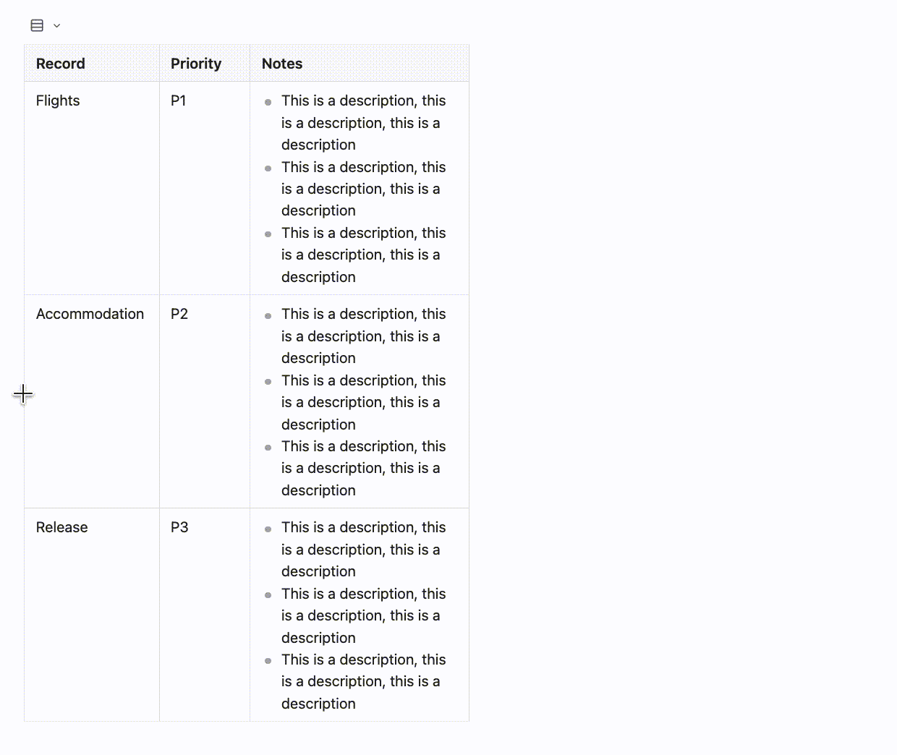

# TreeTable

**[English](README.md) | [简体中文](README.zh-CN.md)**

TreeTable enhances ordinary Markdown tables with foldable groups, nested records, rich cell editing, and draggable column widths. It keeps the table as Markdown data, so your existing notes and AI workflows remain easy to read and edit.

## How to use

1. Create a normal Markdown table.
2. In the first column, use `#` for groups and `>` / `>>` for child records.
3. Click the arrow beside a group or record to fold or unfold it. Click a cell to edit it.

Copy this table to try it:

```md
| Record | Notes |
| --- | --- |
| # Travel |  |
| Flights | Book tickets |
| > Accommodation | Compare hotels |
| >> Tokyo | Stay three nights |
| # Work |  |
| Release | Prepare notes |
```

`# Travel` and `# Work` are groups; `> Accommodation` is a child record; `>> Tokyo` is a second-level child. The table remains understandable Markdown when TreeTable is disabled.

## Features

1. **Groups and nested records**: use simple `#`, `>` and `>>` markers to make a table behave like a foldable tree.
2. **Rich Markdown cells**: edit lists, tasks, images, embeds, and fenced code blocks directly in a cell.
3. **Column widths**: drag the visible separators to resize columns.
4. **Single-line display**: switch long tables to a compact one-line view for scanning.



## Details

TreeTable supports common Markdown content in cells, including lists, tasks, images, embeds, and fenced code blocks. When another enabled plugin provides an interactive code block, TreeTable preserves its display and leaves that block's lifecycle to the other plugin.

Columns without a manual width adapt to their content. You can drag a column to set its width; explicit width metadata can also be written in a header cell, for example `<!-- width=240 -->`. Row-height controls also work with ordinary Markdown tables.

For compact wide tables, use `# Group<br>Field` in a column header to create a horizontal header group.

## Compatibility

TreeTable targets desktop Obsidian and uses the native Markdown table editor.

- Tree-aware dragging for records or whole groups is not supported yet; move the complete subtree in source mode.
- Plugins that rewrite table rows, such as Advanced Tables, may affect tree markers or width metadata. Test compatibility on a copy first.

## Support

If TreeTable helps your workflow, you can support the author through [GitHub Sponsors](https://github.com/sponsors/JWCzju).

## License

[MIT](LICENSE) © Yinno

## Build

```bash
npm install
npm test
npm run build:local   # local Vault build, includes optional Joule integration
npm run build:store   # public build, omits optional private integration
npm run prepare:release # writes the public main.js, manifest.json, and styles.css at the repository root
```

The public build is generated from the same source and uses the same plugin ID: `markdown-treetable`.
